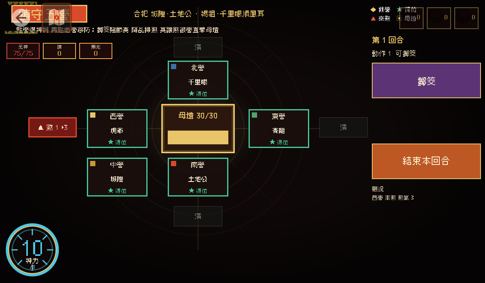
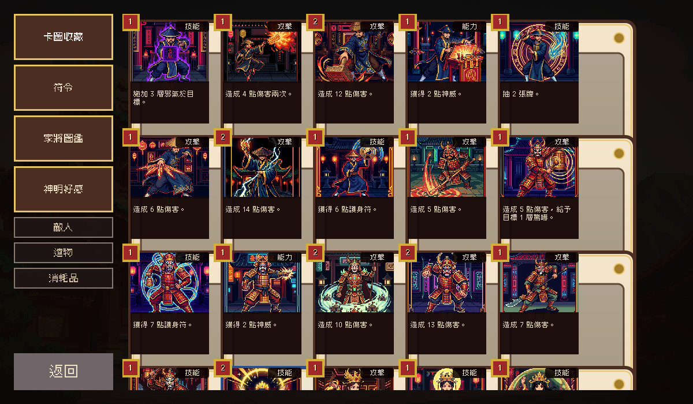
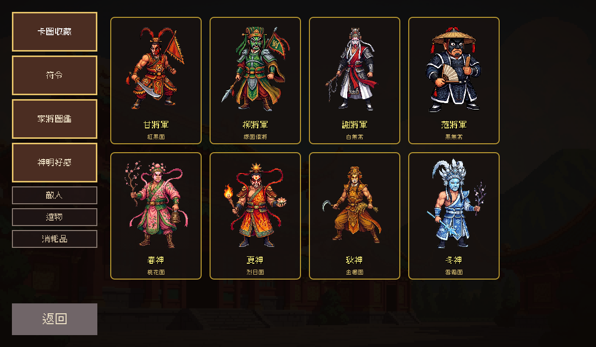
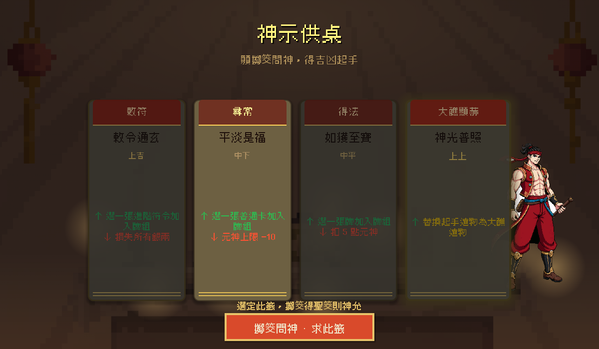

# 鎮島錄 / Chronicles of the Island Ward (COTIW)

> **一款台灣民俗題材的「儀式編排型 roguelike 卡牌手遊」。**
> 玩家透過 **合符、破煞、請神、遶境、修廟**，守護一座被妖煞侵擾的島嶼。
> Godot 4 · iOS + Android · F2P + IAP（不放廣告）

> *A ritual-driven roguelike card battler where players merge talismans, break evil wards, and invoke deities to protect a haunted island.*

---

## 實際執行畫面


更多畫面。以下皆為 Godot 4 實機執行截圖（1200×700 橫向 mobile 版面），非概念圖：

| 主畫面 · 鎮島廟 | 五營鎮守戰鬥 |
|---|---|
|  |  |
| **符令卡牌圖鑑** | **家將圖鑑** |
|  |  |
| **神明圖鑑** | **神示供桌（開局擲筊）** |
|  |  |

---

## 出處與授權

- 本專案以 DesirePathGames 的 [Slay-The-Robot](https://github.com/DesirePathGames/Slay-The-Robot) 為底改作。Slay-The-Robot 是 Godot 4 的肉鴿卡牌遊戲框架，採 MIT 授權。
- 2026-05-16 起從該框架分出，開始做鎮島錄（第一個本專案 commit：2026-05-16）。repo 最前面的 6 個 commit 是原作者的紀錄。
- 原專案的說明文件保留在 [docs/UPSTREAM_README.md](./docs/UPSTREAM_README.md)。
- 授權：MIT，全文見 [LICENSE](./LICENSE)。LICENSE 照原專案保留，著作權行是 `Copyright (c) 2025 DesirePathGames`。

---

## 30 秒理解這個專案

**這不是「殺戮尖塔換台灣皮」。** 它是一款以「儀式編排」為核心的卡牌 roguelike，每一場戰鬥都是一次鎮煞儀式：

| 支柱 | 你在做什麼 | 靈感轉化（非照抄） |
|---|---|---|
| 🪬 **合符** | 手牌兩張同階符可合成升階：一劃符 → 二劃符 → 三劃敕符 | 《重返未來 1999》手牌合成 |
| 💥 **破煞** | 用對「儀法」（拳/符/火/鈴/陣/咒）命中妖怪弱點，削「煞盾」，破煞後開爆發窗口 | 《崩壞：星穹鐵道》弱點擊破 |
| ⛩️ **請神** | 累積請神值、擇時降乩（虎爺破煞、城隍審判、媽祖守護、土地公資源） | 民俗信仰原創 |
| 🏮 **遶境** | 不是爬塔，是出巡遶境：山路 / 廟路 / 夜市路 / 荒宅路，污染越高香火越豐、越危險 | roguelike 路線 |
| 🛕 **修廟** | 香火拿去修復鎮島廟，解鎖神明位 / 法器 / 籤詩，但永遠不賣戰力 | meta progression |

- **開局**不是只選一個職業，而是配置 **主祭 / 護壇 / 法器** 三件班底。
- **變現**的設計原則：只賣外觀 / 角色解鎖 / 支持者內容，不賣戰力、不做戰力 Gacha、不放廣告。
- **v0.3 起戰鬥改成「五營佈陣」**：戰場是東、南、西、北、中五營的羅盤，取代抽手牌、花神力的骨架；符令手牌與神明養成（敕封、緣分合祀）也一併接進戰鬥。設計見 [docs/design/formation_progression_v0.3.md](./docs/design/formation_progression_v0.3.md)。

---

## 目前狀態

- **時間**：2026-05-16 開始，5 月 104 個 commit、6 月 135 個 commit；之後 8 月一次翻譯與主題更新，11 月補上實機截圖。全部共 247 個 commit（含原作者的 6 個）。
- **內容**：4 個角色、5 個營、4 位神明、2 種護壇、3 種法器、4 條遶境路線、6 種修廟建築。（外部資料目錄 `external/data/` 有卡牌資料檔 87 個、敵人 16 個、遺物 28 個、事件 15 個。）
- **已能做的事**：主畫面、新一局選班底、神示供桌擲筊、五營戰鬥、符令手牌、遶境地圖、商店與休息、圖鑑、每日上香、新手導引。
- **測試**：`tests/` 有 55 個測試檔、約 365 個測試函式；每次 push 由 GitHub Actions 跑資料驗證與單元測試，最近一次（2026-11-08）通過。
- **平台**：Android 已做過實機驗收（[紀錄](./docs/archive/ANDROID_VERIFICATION_2026-05-20.md)）；iOS 可匯出 Xcode 專案並建置成功，但 Apple Silicon 的 iOS 模擬器跑不起來（[紀錄](./docs/IOS_EXPORT_SETUP.md)）。iOS 真機：待補。
- **美術**：像素風，規格見 [docs/design/ART_PRODUCTION_STANDARD.md](./docs/design/ART_PRODUCTION_STANDARD.md)。部分素材用 AI 圖像工具生成，生成規格與提示詞留在 `docs/design/production-specs/`。
- **上架**：待補。

---

## 怎麼跑

需要 [Godot](https://godotengine.org/) 4.6（`project.godot` 標示的版本）。

```bash
# 匯入（首次或新增資源後）
godot --headless --import

# 跑全套 headless 測試（exit 0 = 全過）
godot --headless res://tests/TestRunner.tscn

# 開編輯器 / 跑遊戲
godot -e          # 編輯器
godot             # 直接執行
```

- 測試必須以「場景」方式跑（`--script` 不會載入 autoload）。詳見 [tests/README.md](./tests/README.md)。
- 匯出 Android 測試包：`godot --headless --export-debug "Android" build/android/cotiw.apk`，需要 Android SDK 和 JDK，步驟見 [docs/ANDROID_EXPORT_SETUP.md](./docs/ANDROID_EXPORT_SETUP.md)。
- 匯出 iOS：見 [docs/IOS_EXPORT_SETUP.md](./docs/IOS_EXPORT_SETUP.md)。
- 瀏覽器版（Web 匯出）：待補。

---

## 開發原則

1. **資料驅動**：神明、弱點、破煞值都放 JSON，不寫死在程式裡。
2. **mobile-first**：橫向 1200×700。
3. **fork-first**：新增優先，少改 Slay-The-Robot 的核心。
4. **測試要綠**：改動後跑 `TestRunner`；新系統補 validator 或單元測試。

---

## 文件導覽

| 檔案 | 用途 |
|---|---|
| [PRD.md](./PRD.md) | 產品需求文件（儀式編排型定位、四大支柱、角色、遶境、修廟、變現、Phase 計畫） |
| [docs/design/ritual_combat_system.md](./docs/design/ritual_combat_system.md) | 戰鬥總覽：四支柱如何咬合成儀式鏈（先讀這份） |
| [docs/design/ward_break_system.md](./docs/design/ward_break_system.md) | 破煞 / 煞盾系統 |
| [docs/design/talisman_merge_system.md](./docs/design/talisman_merge_system.md) | 符階合成系統 |
| [docs/design/deity_invocation_system.md](./docs/design/deity_invocation_system.md) | 請神系統 |
| [docs/design/pilgrimage_route_system.md](./docs/design/pilgrimage_route_system.md) | 遶境地圖系統 |
| [docs/design/meta_temple_progression.md](./docs/design/meta_temple_progression.md) | 修廟 meta progression |
| [docs/design/formation_progression_v0.3.md](./docs/design/formation_progression_v0.3.md) | v0.3：五營陣型與神明養成 |
| [docs/UPSTREAM_README.md](./docs/UPSTREAM_README.md) | 原專案 Slay-The-Robot 的說明 |

**資料目錄**：`external/data/{deities,guardians,ritual_tools,route_traits,meta_buildings,formation_camps}/` 等
**系統腳本**：`scripts/systems/ritual/`
**資料類別**：`data/prototype/`

---

## 作者

憲龍（GitHub：[kiresakura](https://github.com/kiresakura)）
